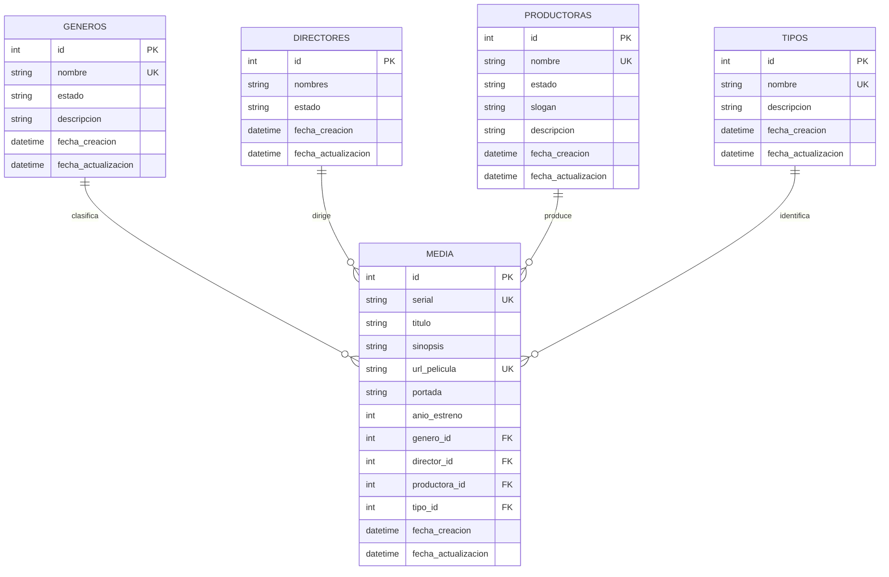

# Modelo entidad–relación

La relación entre las tablas se expresa en Mermaid. Puede previsualizarse en GitHub o en un editor compatible.

**Notas:** Una producción tiene exactamente un género, un director, una productora y un tipo; cada catálogo puede ser reutilizado por múltiples producciones. `UK` significa valor único.
